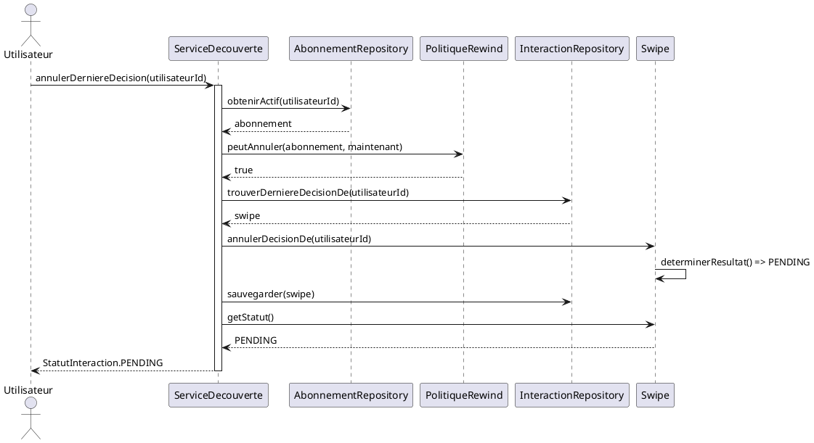

# Réponses exercice 1 : Rewind

## Partie A

| # | Responsabilité | Couche |
|---|----------------|--------|
| 1 | Retirer la dernière décision et recalculer le statut | Domaine (agrégat) |
| 2 | Vérifier que l'utilisateur a un abonnement actif | Domaine (policy) |
| 3 | Retrouver en base la dernière interaction décidée | Adaptateur (infra) |
| 4 | Orchestrer droit, chargement, annulation, sauvegarde | Service applicatif |
| 5 | Déclarer `trouverDerniereDecisionDe(utilisateurId)` | Port (application) |
| 6 | Écrire la requête SQL concrète | Adaptateur (infra) |
| 7 | Décider qu'une annulation remet le statut à `PENDING` | Domaine (agrégat) |

## Partie B

1. Le domaine importe l'infrastructure, donc la dépendance part du domaine vers l'infra au lieu de l'inverse. La policy crée aussi l'adaptateur toute seule avec `new`, elle ne passe pas par le port et fait un accès aux données alors qu'elle devrait seulement appliquer une règle.
2. On ne peut pas lui passer un faux repository puisqu'elle crée le sien. Pour tester une simple règle métier il faudrait le vrai stockage, et plus tard une vraie base.
3. `peutAnnuler(abonnement: Abonnement | null, aLaDate: Date): boolean`

## Partie B′

C'est le service qui charge l'abonnement et le donne à la policy. `Swipe` ne parle à aucun repository.

## Partie C

| Morceau | Fichier |
|---------|---------|
| C.1 `annulerDecisionDe` | `src/domain/swipe.ts` |
| C.2 `PolitiqueRewind` | `src/domain/politique-rewind.ts` |
| C.3 `trouverDerniereDecisionDe` | `src/application/ports/interaction-repository.ts` |
| C.4 `annulerDerniereDecision` | `src/application/service-decouverte.ts` |

J'ai ajouté `dateDecisionDe(emetteurId)` sur `Swipe` pour que l'adaptateur retrouve la décision la plus récente sans exposer le tableau privé. Si l'autre participant avait dit NON, le statut reste `NO_MATCH` après l'annulation.

Tests dans `tests/rewind.test.ts`.
