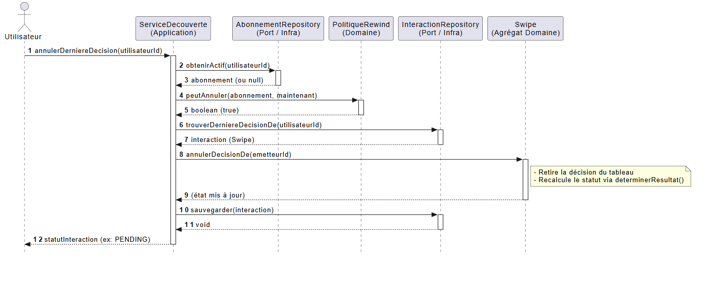

# 🎯 Exercice — Concevoir une tranche verticale en archi hexagonale

## 🧩 Partie A — Comprendre : classer les responsabilités (10 min)

Pour chacune des 7 responsabilités ci-dessous, indique dans **quelle couche** elle doit vivre :
`Domaine (agrégat)` · `Domaine (policy)` · `Port (application)` · `Service applicatif` · `Adaptateur (infra)`.

| # | Responsabilité | Couche ? |
|---|----------------|----------|
| 1 | Retirer la dernière décision d'une interaction et recalculer son statut | Domaine (agrégat) |
| 2 | Vérifier que l'utilisateur a un abonnement actif pour avoir le droit d'annuler | Domaine (policy) |
| 3 | Retrouver en base la dernière interaction où l'utilisateur a pris une décision | Adaptateur (infra) |
| 4 | Orchestrer : vérifier le droit → charger l'interaction → annuler → sauvegarder | Service applicatif |
| 5 | Déclarer l'interface `trouverDerniereDecisionDe(utilisateurId)` | Port (application) |
| 6 | Écrire la requête SQL concrète qui lit la dernière interaction | Adaptateur (infra) |
| 7 | Décider qu'une annulation remet le statut à `PENDING` | Domaine (agrégat) |

## 🔍 Partie B — Analyser : repérer la violation (10 min)

Un collègue propose ce code pour la policy de rewind. **Identifie la ou les violations de l'architecture hexagonale** et explique pourquoi c'est un problème.

```typescript
// src/domain/politique-rewind.ts
import { InMemoryAbonnementRepository } from '../infrastructure/in-memory-abonnement-repository.js';

export class PolitiqueRewind {
  private readonly repo = new InMemoryAbonnementRepository();

  async peutAnnuler(utilisateurId: UtilisateurId): Promise<boolean> {
    const abonnement = await this.repo.obtenirActif(utilisateurId);
    return abonnement !== null && abonnement.estActif(new Date());
  }
}
```

Questions :
1. Quelle(s) règle(s) de l'hexagone ce code viole-t-il ? (sois précis sur la direction de dépendance)
2. Quel problème concret cela pose-t-il pour **tester** cette policy ?
3. Propose la **signature corrigée** de `peutAnnuler(...)` (sans implémentation), qui respecte l'hexagone.

---

1)

```typescript
import { InMemoryAbonnementRepository } from '../infrastructure/in-memory-abonnement-repository.js';
```
Regle violé : La règle de direction des dépendances de l'architecture hexagonale
Problème : C'est une violation directe du principe qui dit que le domaine ne connaît personne et ne dépend de rien d'externe. Le dossier domain/ ne doit jamais remonter ou pointer vers infrastructure/ ou application/ (l'extérieur). 


```typescript
private readonly repo = new InMemoryAbonnementRepository();
```
Regle violé : Le principe d'inversion des dépendances (DIP - SOLID)
Problème : En plus du mauvais sens de la dépendance, le domaine s'associe en dur (new) à une implémentation concrète précise (InMemory...). En cas de changement vers une autre BDD (ex: PostgreSQL), la modification du code de la policy métier devient obligatoire. Le domaine doit exclusivement dépendre d'abstractions (des interfaces / ports) et jamais de classes concrètes.


```typescript
async peutAnnuler(...)
await this.repo.obtenirActif(utilisateurId);
```
Regle violé : Le principe de pureté et de synchronicité du domaine métier (absence d'I/O
Problème : Un domaine doit contenir de la logique métier pure, effectuer des calculs, appliquer des règles et vérifier des états de manière synchrone et déterministe. Réaliser des requêtes réseau ou base de données (async/await) à l'intérieur du domaine le transforme en un composant lent, couplé à l'état de la base de données, et difficile à maintenir. L'orchestration et la récupération des données relèvent de la responsabilité du service applicatif (via les ports).


```typescript
new Date()
```
Regle violé : Le principe de déterminisme des fonctions métier (absence d'effets de bord liés au temps système).
Problème : Bien que ce ne soit pas une violation d'import, utiliser new Date() directement dans le code métier crée un effet de bord caché lié au temps système. Ton code devient non-déterministe : si tu écris un test unitaire aujourd'hui, il passera peut-être, mais il pourra échouer demain selon la date courante de la machine ou le fuseau horaire du serveur. C'est pour cela qu'une policy idéale reçoit la date en paramètre (aLaDate: Date), rendant la fonction 100% prévisible et testable.

3)
```typescript
peutAnnuler(abonnement: Abonnement | null, aLaDate: Date): boolean
```

## 🧭 Partie B′ — Appliquer : dessiner le diagramme de séquence (10 min)


@startuml
autonumber
skinparam BoxPadding 10
skinparam ParticipantPadding 10
skinparam Style strictuml

actor "Utilisateur" as User
participant "ServiceDecouverte\n(Application)" as Service
participant "AbonnementRepository\n(Port / Infra)" as AboRepo
participant "PolitiqueRewind\n(Domaine)" as Policy
participant "InteractionRepository\n(Port / Infra)" as InteractionRepo
participant "Swipe\n(Agrégat Domaine)" as Swipe

User -> Service : annulerDerniereDecision(utilisateurId)
activate Service

Service -> AboRepo : obtenirActif(utilisateurId)
activate AboRepo
AboRepo --> Service : abonnement (ou null)
deactivate AboRepo

Service -> Policy : peutAnnuler(abonnement, maintenant)
activate Policy
Policy --> Service : boolean (true)
deactivate Policy

Service -> InteractionRepo : trouverDerniereDecisionDe(utilisateurId)
activate InteractionRepo
InteractionRepo --> Service : interaction (Swipe)
deactivate InteractionRepo

Service -> Swipe : annulerDecisionDe(emetteurId)




## 🛠️ Partie C — Créer : implémenter la tranche verticale (25 min)

voir Pull request

C1 :

Justification : La méthode annulerDecisionDe est placée directement dans l'agrégat Swipe car elle manipule l'état interne de l'interaction (this.decisions) et applique la règle métier garantissant la cohérence des données métier (retirer la décision et recalculer le statut via determinerResultat). Le domaine reste totalement pur et indépendant de toute infrastructure.

C2
Justification : Cette règle métier (« qui a le droit de faire un rewind ? ») est isolée dans une classe de Policy dédiée au sein du domaine. C'est une fonction pure : elle ne fait aucun accès base de données, n'importe aucun adaptateur et prend la date en paramètre, garantissant un test unitaire simple, rapide et déterministe.

C3 :

Justification : L'ajout de la méthode trouverDerniereDecisionDe dans le port d'application définit le contrat nécessaire pour répondre au besoin du Rewind, sans figer la technologie de stockage sous-jacente. L'infrastructure (les adaptateurs) se chargera d'implémenter cette interface.

C4 :

Justification : La méthode annulerDerniereDecision est placée dans le service applicatif (ServiceDecouverte) car elle coordone le cas d'usage complet (l'orchestration) : elle récupère les données externes via les ports (I/O asynchrones), interroge la police de métier, délègue la modification de l'état à l'agrégat du domaine, et persiste les modifications. Le service ne contient aucune logique métier « dure », il se contente de l'orchestrer.