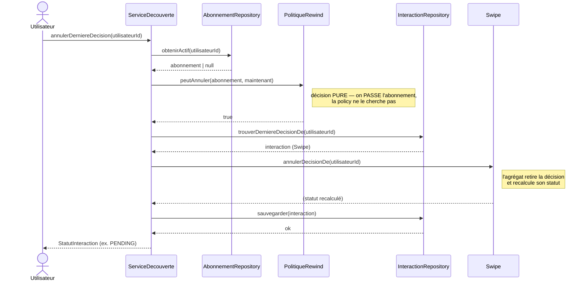

# 📝 Solution — Exercice « Tranche verticale en archi hexagonale » (étape 1)

> Mes réponses à `exercice-hexagonale.md`. La tranche verticale (Partie C) est
> implémentée dans le code (`src/`) et couverte par `tests/rewind.test.ts`.

---

## 💡 L'idée en une phrase

La règle d'or de l'hexagone : **les dépendances pointent toujours vers le domaine**
(`infrastructure → application → domaine`). Implémenter une fonctionnalité, ce n'est pas
coder une couche entière, c'est **répartir ses responsabilités dans la bonne couche** — du
cœur métier (les règles) vers l'extérieur (les détails techniques), sans jamais que le domaine
ne connaisse l'infra. Le **Rewind** est une *tranche verticale* qui traverse les 4 couches :
agrégat → policy → port → service.

```
Utilisateur ──▶ ServiceDecouverte ──▶ PolitiqueRewind (règle)   ← domaine
  (infra)          (application)   └─▶ Swipe (invariant)        ← domaine
                        └──────────▶ InteractionRepository      ← port (application)
                                     └─▶ adaptateur in-memory   ← infra
```

---

## 🧩 Partie A — Classement des responsabilités

| # | Responsabilité | Couche | Justification |
|---|----------------|--------|---------------|
| 1 | Retirer la dernière décision + recalculer le statut | **Domaine (agrégat)** | Invariant interne de `Swipe` : lui seul protège la cohérence de ses décisions. |
| 2 | Vérifier que l'utilisateur a un abonnement actif | **Domaine (policy)** | Règle métier transverse (premium requis) → *Domain Policy* pure. |
| 3 | Retrouver en base la dernière interaction décidée | **Adaptateur (infra)** | Implémentation concrète de l'accès aux données. |
| 4 | Orchestrer : droit → charger → annuler → sauvegarder | **Service applicatif** | Coordonne domaine + ports, sans porter de règle métier dure. |
| 5 | Déclarer l'interface `trouverDerniereDecisionDe(...)` | **Port (application)** | Le *contrat* appartient à l'application qui le consomme. |
| 6 | Écrire la requête SQL concrète | **Adaptateur (infra)** | Détail technique interchangeable (SQL / mémoire / API). |
| 7 | Décider qu'une annulation remet le statut à `PENDING` | **Domaine (agrégat)** | Règle de transition d'état → appartient à `Swipe`. |

**Clé** : *déclarer* un port (#5) ≠ *l'implémenter* (#3, #6). Le contrat vit côté application,
l'implémentation côté infra — c'est l'inversion de dépendance qui rend le domaine indépendant.

### La méthode : 4 questions pour trouver la bonne couche

Pour chaque responsabilité, on se pose **une seule question** et la couche en découle :

| Question | Si oui → couche | Exemples ici |
|----------|-----------------|--------------|
| Est-ce une **règle métier** qui protège la cohérence d'un agrégat ? | **Domaine (agrégat)** | #1, #7 — retirer une décision, transition vers `PENDING` |
| Est-ce une **décision métier transverse** (combine plusieurs concepts) ? | **Domaine (policy)** | #2 — « premium requis pour annuler » |
| Est-ce un **contrat** dont l'application a besoin pour parler à l'extérieur ? | **Port (application)** | #5 — l'interface `trouverDerniereDecisionDe` |
| Est-ce un **détail technique remplaçable** (SQL, mémoire, HTTP) ? | **Adaptateur (infra)** | #3, #6 — requête concrète, accès au stockage |
| Est-ce de la **coordination** sans règle métier propre ? | **Service applicatif** | #4 — enchaîner droit → charger → annuler → sauvegarder |

**Le piège le plus courant** oppose #5 et #3/#6 : *déclarer* un port n'est pas *l'implémenter*.
Le **contrat** (`interface`) appartient à l'application — c'est **elle** qui en a besoin et qui
dicte sa forme. L'**implémentation** (requête SQL, map en mémoire) est un détail qui vit dans
l'infra et reste **interchangeable**. C'est précisément cette inversion — l'application définit,
l'infra obéit — qui permet au domaine d'ignorer totalement la technique, et donc de rester
testable et stable quand la base de données change.

---

## 🔍 Partie B — Violation repérée

### 1. Direction de dépendance inversée (violation majeure)
`src/domain/politique-rewind.ts` **importe `src/infrastructure/...`**. Le domaine dépend de
l'infrastructure, soit l'exact inverse de la règle `infra → application → domaine`. Le cœur
métier se couple à un détail technique (le stockage).

### 2. La policy fait de l'I/O
`peutAnnuler` est `async` et **va chercher** les données (`await this.repo...`). Une *Domain
Policy* doit être une **décision pure** : on lui *passe* l'abonnement, elle ne le charge pas.
C'est le rôle du service applicatif.

### 3. Problème pour les tests
On ne peut pas tester `peutAnnuler` sans instancier un vrai repository → test lent, couplé,
et difficile à simuler (« abonnement expiré », « pas d'abonnement »). Une fonction pure se
teste en une ligne, sans mock (cf. `tests/rewind.test.ts`).

### Signature corrigée
```typescript
// src/domain/politique-rewind.ts — pure, synchrone, aucune dépendance infra
peutAnnuler(abonnement: Abonnement | null, aLaDate: Date): boolean
```

---

## 🧭 Partie B′ — Diagramme de séquence (cas nominal)



**Ce que le diagramme garantit** : le **service** est le seul pilote. Le domaine
(`PolitiqueRewind`, `Swipe`) reçoit ses données en paramètre et **n'appelle jamais** un port.
Deux anti-patterns évités : la policy ne va pas chercher l'abonnement, et l'agrégat ne se
persiste pas lui-même.

---

## 🛠️ Partie C — Tranche verticale (implémentée dans le code)

| Étape | Fichier | Élément |
|-------|---------|---------|
| C.1 | `src/domain/swipe.ts` | `annulerDecisionDe()` + `aDecisionDe()` |
| C.2 | `src/domain/politique-rewind.ts` | `PolitiqueRewind.peutAnnuler()` (pure) |
| C.3 | `src/application/ports/interaction-repository.ts` | `trouverDerniereDecisionDe()` |
| C.4 | `src/application/service-decouverte.ts` | `annulerDerniereDecision()` (injection de `PolitiqueRewind`) |
| Infra | `src/infrastructure/in-memory-interaction-repository.ts` | implémentation du nouveau port |

### Les décisions pédagogiques importantes

**C.1 — La règle d'annulation vit dans l'agrégat (encapsulation)**
```typescript
annulerDecisionDe(emetteurId: UtilisateurId): void {
  const index = this.decisions.findIndex((d) => d.emetteurId === emetteurId);
  if (index === -1) return;          // idempotent : rien à annuler
  this.decisions.splice(index, 1);
  this.determinerResultat();         // on RÉUTILISE la logique de statut existante
}
```
Le tableau `decisions` reste **privé** : on n'expose pas la donnée, on expose un **comportement**
(`annulerDecisionDe`). C'est l'agrégat — et lui seul — qui sait comment rester cohérent. On ne
réécrit pas le calcul du statut : on rappelle `determinerResultat()`, qui ramène à `PENDING`
quand il n'y a plus deux OUI. `aDecisionDe()` n'est qu'un **accesseur en lecture** utilisé par
l'infra pour retrouver la bonne interaction, sans jamais ouvrir le tableau en écriture.

**C.2 — La policy est une fonction pure (testable sans base)**
```typescript
peutAnnuler(abonnement: Abonnement | null, aLaDate: Date): boolean {
  return abonnement?.estActif(aLaDate) ?? false;
}
```
On **passe** l'abonnement (déjà chargé par le service) ; la policy ne va rien chercher. Elle est
**synchrone**, sans dépendance infra, donc testable en une ligne (`peutAnnuler(null, date) === false`).
Elle **réutilise** `Abonnement.estActif(...)` plutôt que de redéfinir la règle d'activité : chaque
règle vit à un seul endroit.

**C.3 — Le port est un contrat minimal, déclaré côté application**
```typescript
// src/application/ports/interaction-repository.ts
trouverDerniereDecisionDe(utilisateurId: UtilisateurId): Promise<Swipe | null>;
```
Le contrat renvoie `Swipe | null` : le `null` encode honnêtement le cas « rien à annuler » et
**force le service à le gérer**. L'interface vit dans `application/` (celui qui en a besoin) ;
l'implémentation concrète vit dans `infrastructure/`. Le domaine, lui, n'est au courant de rien.

**C.4 — Le service orchestre, sans règle métier en dur**
```typescript
async annulerDerniereDecision(utilisateurId, maintenant = new Date()) {
  const abonnement = await this.abonnements.obtenirActif(utilisateurId); // 1. charge
  if (!this.rewind.peutAnnuler(abonnement, maintenant))                  // 2. délègue la RÈGLE
    throw new Error('Rewind réservé aux abonnés premium');
  const interaction = await this.interactions.trouverDerniereDecisionDe(utilisateurId); // 3. charge
  if (!interaction) throw new Error('Aucune décision à annuler');
  interaction.annulerDecisionDe(utilisateurId);                          // 4. délègue l'ACTION métier
  await this.interactions.sauvegarder(interaction);                      // 5. persiste
  return interaction.getStatut();
}
```
Le service ne fait que **coordonner** : il ne décide pas lui-même qui a le droit (c'est la policy)
ni comment annuler (c'est l'agrégat). Il reçoit `PolitiqueRewind` par **injection dans le
constructeur** — jamais via un `new` — exactement comme les autres dépendances. Résultat : aucune
règle métier dure dans l'application, et on peut substituer une fausse policy/un faux repo en test.

**Infra — l'adaptateur implémente le contrat (détail remplaçable)**
```typescript
async trouverDerniereDecisionDe(utilisateurId) {
  for (let i = this.ordreSauvegarde.length - 1; i >= 0; i -= 1) {
    const interaction = this.parCle.get(this.ordreSauvegarde[i]);
    if (interaction?.aDecisionDe(utilisateurId)) return interaction;     // la plus récente d'abord
  }
  return null;
}
```
Stratégie « dernière sauvegardée en premier » propre à l'implémentation mémoire. Une vraie base
ferait un `ORDER BY date DESC LIMIT 1` : **la logique change, le contrat reste**. C'est tout
l'intérêt du port.

**Vérification** : `npm run typecheck` ✅ · `npm test` → 12 tests verts (dont 8 nouveaux dans
`tests/rewind.test.ts`). La policy est testée comme fonction pure, sans base de données.

---

## ⚠️ Pièges évités

1. **Mettre « premium requis » en `if/else` dans le service** au lieu d'une policy → la règle
   métier devient non réutilisable et non testable isolément. Ici elle vit dans `PolitiqueRewind`.
2. **Rendre `decisions` public** pour que le service retire lui-même la décision → casse
   l'encapsulation de l'agrégat. C'est à `Swipe` de protéger ses invariants (`annulerDecisionDe`).
3. **Faire porter l'I/O à la policy** (`async`, accès repo) → une policy est une **décision pure** :
   on lui passe l'abonnement, elle ne le charge pas.
4. **Instancier l'adaptateur dans le service/la policy** (`new InMemory...`) au lieu de l'injecter
   → recrée un couplage fort à la technique et empêche de substituer un faux en test.
5. **Déclarer le port dans `infrastructure/`** → le contrat appartient à l'**application** qui le
   consomme ; seule son implémentation vit dans l'infra.
6. **Faire renvoyer autre chose que `Swipe | null` par le port** (ex. lever une exception quand il
   n'y a rien) → le `null` explicite force le service à gérer le cas « rien à annuler ».
